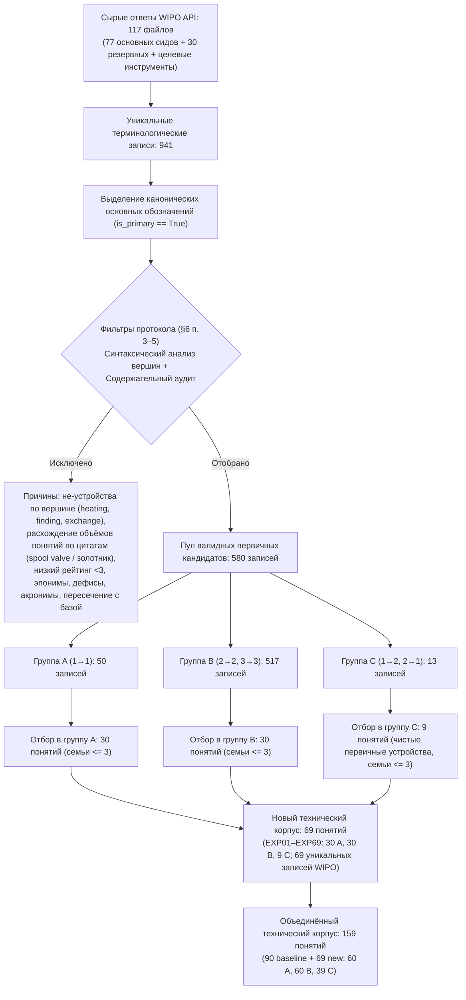

# Научный отчёт: Расширение технической и контрольной выборки (WIPO Pearl + Бытовой контроль v1)

**Дата фиксации**: 2026-09-20  
**Версия протокола**: `expansion_wipo_v1` (редакция v1.2: исключение семантически неэквивалентной пары `EXP69: spool valve / золотник`, содержательный аудит цитат WIPO, отражение истории фиксации в `FREEZE.json`)  
**Использованный seed бутстрэпа**: `20260918` (5000 повторов на связных компонентах совместных кластеров)  
**Порог практической эквивалентности (TOST)**: $|\ln R| \le 0{,}095$ ($\approx 10\%$, интервал эквивалентности $[0{,}9094; 1{,}0997]$)  

---

## 1. Схема движения кандидатов (Воронка отбора)

### Движение контрольного пула:
- **Доступно исходных кандидатов контроля (Concepticon S1 + Wiktionary S2)**: 877 понятий.
- **Зарезервировано базовым срезом (Baseline)**: 76 понятий (не подлежат повторному использованию).
- **Свободный пул кандидатов контроля**: 801 понятие (604 в ячейке 1_1, 67 в 1_2, 6 в 1_3, 3 в 2_1, 100 в 2_2, 4 в 2_3, 14 в 3_2, 3 в 3_3).
- **Исключения из контроля (`manual_exclusions.csv`)**: 14 понятий строго исключены по терминам и парам («четвертое измерение», «психиатрическая больница», «бумагопрядильня», дубль «occasional table / журнальный столик» и др.). Ни одно исключённое понятие не допущено в выборку.
- **Успешно сопоставлено новых пар** (допуск длины $\le 4$ знака в обоих языках, точное равенство числа слов, размер семьи контроля $\le 3$): **55 пар** (29 в A, 21 в B, 5 в C).
- **Не найдено пар в заданных границах** среди новых 69 понятий: **14 понятий** (1 в A, 9 в B, 4 в C; сохранены в `unmatched_technical.csv` и анализируются в несвязанных тестах H1–H3).
- **Исторические 14 понятий базового среза без пары**: при строгом калипере $\le 4$ и лимите семей новых пар не найдено (остаются несопоставленными, калипер искусственно не расширялся).
- **Итоговый объединённый сопоставленный контроль**: **131 пара** (76 baseline + 55 new; **110 независимых совместных кластеров**).

---

## 2. Содержательный аудит WIPO: исключения, спорные случаи и верификация цитат

Автоматическая выгрузка WIPO Pearl содержит случаи, когда поверхностно переведённые термины имеют расходящиеся объёмы понятий в реальных патентных цитатах. По результатам содержательного анализа контекстов внесены следующие решения:

### 2.1. Обоснование исключения спорной пары `spool valve` $\leftrightarrow$ `золотник`
- **Запись WIPO**: `ru_золотник_p01.json#rec_0` (term IDs: EN `10019753`, RU `10019754`).
- **Контекст цитаты EN**: *«Spool valves control, i.e., switch, the direction of flow of a hydraulic fluid by moving a spool axially along a longitudinal axis within a bore of a valve housing between at least a first position and a second position...»* (речь идёт о **золотниковом гидрораспределителе**).
- **Контекст цитаты RU**: *«В корпус клапана регулировки давления вкручивается золотник для накачивания герметичной полости воздухом, закрытый пластмассовым колпачком.»* (речь идёт о **пневматическом ниппеле/золотнике Шрадера** для накачки воздухом).
- **Обоснование исключения**: Объёмы понятий принципиально расходятся. Английский термин обозначает гидравлический распределительный узел (spool valve), тогда как русский патентный контекст использует слово «золотник» в бытовом/автомобильном значении вкручиваемого ниппеля для накачивания полости. Данная запись была ранее обоснованно исключена в первичной фильтрации (`scripts/wipo_select.py:41`). Попытка её включения была ошибкой; запись **окончательно исключена из официального корпуса**.

### 2.2. Проверка остальных исключений первичного отбора (`scripts/wipo_select.py:38-45`)
- `8906644: charge exchange → обдирка`: подтверждён статус технологического процесса (перезарядка ионов), исключён по фильтру не-устройств.
- `8833767: radio direction finding → радиопеленгация`: подтверждён статус метода/процесса радионавигации, исключён по фильтру не-устройств.

### 2.3. Содержательная проверка 7 чувствительных терминов резервного списка (`RESERVE_MANUAL`)
1. **`EXP02: cage` $\leftrightarrow$ `сепаратор`** (`bearing_p01.json#rec_24`, ID `10022719`, область `MECH: Bearings`):
   - *Контекст EN*: *«The invention is concerned with cages of the kind having an annular wall and spaced part-spherical pockets...»*
   - *Контекст RU*: *«Подшипник содержит наружное и внутреннее кольца... сепаратор и тела качения... монтажные поверхности колец и сепаратора...»*
   - *Решение*: **Принято**. В контексте подшипниковых узлов термины полностью тождественны (обойма/сепаратор, удерживающий тела качения). Бытовая полисемия (клетка / молочный сепаратор) не влияет на техническую терминологию.
2. **`EXP04: turn` $\leftrightarrow$ `витки`** (`coil_p01.json#rec_1`, ID `10022878`, область `MECH: Springs` / электротехника):
   - *Контекст EN*: *«...the turns of one coil are formed so as to pass through the turns of the other coil.»*
   - *Контекст RU*: *«...с образованием витков некруглой формы... причем каждый виток каждой обмотки имеет...»*
   - *Решение*: **Принято**. В электротехнике катушек и механике пружин «turn» и «виток» являются строгими эквивалентами (один оборот спиральной намотки). Форма множественного числа исправлена на нормативную «витки» (учтена беглая гласная `о`).
3. **`EXP18: probe` $\leftrightarrow$ `щуп`** (`probe_p01.json#rec_0`, ID `9943158`, область `MEAS: Measuring instruments`):
   - *Контекст EN*: *«...a technician typically probes the components using a probe to test for continuity...»*
   - *Контекст RU*: *«Для отладки схем, поиска и диагностики неисправностей... применяются щупы осциллографов и логических анализаторов...»*
   - *Решение*: **Принято**. Оба термина обозначают измерительный контактный пробник/щуп контрольно-измерительной аппаратуры.
4. **`EXP22: terminator` $\leftrightarrow$ `терминатор`** (`resistor_p01.json#rec_4`, ID `8935316`, область `ELEC: Electronic components`):
   - *Контекст EN*: *«A terminator is a dissipative load, typically a resistor, located at the end of a transmission line... to prevent reflections.»*
   - *Контекст RU*: *«...R1, R2, R3, R5, R6 подключены к неиспользуемым входам IC1 и являются терминаторами (защитными нагрузками неиспользуемых входов / согласующими нагрузками шины)...»*
   - *Решение*: **Принято**. В промышленной автоматизации (интерфейсы RS-485, CAN, Profibus) «терминатор» — нормативный заимствованный термин для согласующей резистивной нагрузки шины передачи данных.
5. **`EXP61: bushing` $\leftrightarrow$ `фильерный питатель`** (`bushing_p01.json#rec_0`, ID `8967547`, область `MANU: Rolling, extruding & drawing`):
   - *Контекст EN*: *«...distributes it evenly into a glass fiber bushing. The bushing is comprised of an electrically heated trough made of precious metal...»*
   - *Контекст RU*: *«К основному технологическому оборудованию прядильной ячейки можно отнести: фильерные питатели (бушинги) с количеством фильер...»*
   - *Решение*: **Принято**. Узкоспециализированное, но абсолютно точное соответствие в технологии непрерывного стекло- и базальтоволокна: платиновый питатель с фильерами в англоязычной нормативной литературе именуется именно *bushing*.
6. **`EXP63: impeller` $\leftrightarrow$ `рабочее колесо`** (`impeller_p01.json#rec_0`, ID `8841638`, область `MECH: Turbines`):
   - *Контекст EN*: *«...an impeller which is rigidly connected to the torque converter housing; a turbine... and a stator...»*
   - *Контекст RU*: *«Рабочее колесо состоит из фланца с жестко закрепленными на нем и оппозитно расположенными лопатками и ребрами...»*
   - *Решение*: **Принято**. В ГОСТ 17398-72 («Насосы. Термины и определения») вращающийся лопастной ротор центробежной гидромашины стандартизован как «рабочее колесо», что в англоязычной норме строго соответствует «impeller».
7. **`EXP64: oscillator` $\leftrightarrow$ `генератор сигналов`** (`oscillator_p01.json#rec_0`, ID `8930392`, область `ELEC: Electronic components`):
   - *Контекст EN*: *«Oscillators are well known devices for providing a reference frequency source. The oscillator typically has a quartz crystal...»*
   - *Контекст RU*: *«Генераторы сигналов являются неотъемлемым элементом... Это могут быть синусоидальные генераторы несущей частоты... тактовые генераторы...»*
   - *Решение*: **Принято**. В контрольно-измерительной технике и радиоэлектронике электронный кварцевый автогенератор сигналов (oscillator) стандартно обозначается как генератор сигналов / автогенератор.

---

## 3. Сплошной построчный аудит всех 69 принятых понятий

Ниже представлена полная сводная таблица всех 69 понятий нового среза WIPO (`EXP01`–`EXP69`), подтверждающая корректность предметного типа, эквивалентности перевода и нормативности грамматических форм:

| ID | Stratum | EN SG | EN PL | RU SG | RU PL | Статус формы PL | Предметный тип (устройство/компонент) | Эквивалентность перевода | Решение и обоснование |
|---|---|---|---|---|---|---|---|---|---|
| EXP01 | A (1_1) | micrometer | micrometers | микрометр | микрометры | Корректно | Физический измерительный прибор | Точный эквивалент (WIPO `micrometer_p01.json#rec_0`) | **Принято**: физический прибор, канонический термин |
| EXP02 | A (1_1) | cage | cages | сепаратор | сепараторы | Корректно | Деталь подшипника качения | Точный эквивалент (WIPO `bearing_p01.json#rec_24`) | **Принято**: деталь подшипника, цитаты выверены |
| EXP03 | A (1_1) | caliper | calipers | штангенциркуль | штангенциркули | Корректно | Инструмент линейных измерений | Точный эквивалент (WIPO `caliper_p01.json#rec_0`) | **Принято**: инструмент измерений |
| EXP04 | A (1_1) | turn | turns | виток | витки | **Исправлено**: «витки» (беглая `о`) | Конструктивный элемент индуктивности | Точный эквивалент (WIPO `coil_p01.json#rec_1`) | **Принято**: элемент обмотки, форма PL исправлена |
| EXP05 | A (1_1) | commutator | commutators | коллектор | коллекторы | Корректно | Электромеханический узел электромашины | Точный эквивалент (WIPO `commutator_p01.json#rec_0`) | **Принято**: компонент электрических машин |
| EXP06 | A (1_1) | servocontroller | servocontrollers | сервоконтроллер | сервоконтроллеры | Корректно | Электронный блок управления приводом | Точный эквивалент (WIPO `controller_p01.json#rec_2`) | **Принято**: устройство автоматизации |
| EXP07 | A (1_1) | optocoupler | optocouplers | оптопара | оптопары | Корректно | Оптоэлектронный полупроводниковый прибор | Точный эквивалент (WIPO `coupler_p01.json#rec_5`) | **Принято**: электронный компонент |
| EXP08 | A (1_1) | varactor | varactors | варикап | варикапы | Корректно | Полупроводниковый диод с переменной ёмкостью | Точный эквивалент (WIPO `diode_p01.json#rec_4`) | **Принято**: электронный компонент |
| EXP09 | A (1_1) | ejector | ejectors | выталкиватель | выталкиватели | Корректно | Механический исполнительный узел | Точный эквивалент (WIPO `ejector_p01.json#rec_0`) | **Принято**: узел оснастки / пресс-формы |
| EXP10 | A (1_1) | galvanometer | galvanometers | гальванометр | гальванометры | Корректно | Электроизмерительный прибор тока | Точный эквивалент (WIPO `galvanometer_p01.json#rec_0`) | **Принято**: измерительный прибор |
| EXP11 | A (1_1) | inverter | inverters | инвертор | инверторы | Корректно | Силовой преобразователь частоты | Точный эквивалент (WIPO `inverter_p01.json#rec_0`) | **Принято**: силовой электронный блок |
| EXP12 | A (1_1) | microbolometer | microbolometers | микроболометр | микроболометры | Корректно | Тепловой датчик излучения | Точный эквивалент (WIPO `meter_p01.json#rec_12`) | **Принято**: первичный сенсор излучения |
| EXP13 | A (1_1) | tribometer | tribometers | трибометр | трибометры | Корректно | Прибор измерения силы трения | Точный эквивалент (WIPO `meter_p01.json#rec_14`) | **Принято**: лабораторно-цеховой прибор |
| EXP14 | A (1_1) | opacimeter | opacimeters | дымомер | дымомеры | Корректно | Оптический прибор измерения задымленности | Точный эквивалент (WIPO `meter_p01.json#rec_17`) | **Принято**: оптический датчик контроля сред |
| EXP15 | A (1_1) | rheometer | rheometers | реометр | реометры | Корректно | Прибор измерения реологии сред | Точный эквивалент (WIPO `meter_p02.json#rec_1`) | **Принято**: измерительный прибор вязкости |
| EXP16 | A (1_1) | spectrophotometer | spectrophotometers | спектрофотометр | спектрофотометры | Корректно | Оптико-аналитический прибор | Точный эквивалент (WIPO `photometer_p01.json#rec_0`) | **Принято**: спектральный анализатор |
| EXP17 | A (1_1) | potentiometer | potentiometers | потенциометр | потенциометры | Корректно | Регулируемый резистивный датчик | Точный эквивалент (WIPO `potentiometer_p01.json#rec_0`) | **Принято**: резистивный датчик положения |
| EXP18 | A (1_1) | probe | probes | щуп | щупы | Корректно | Измерительный контактный элемент | Точный эквивалент (WIPO `probe_p01.json#rec_0`) | **Принято**: измерительный щуп прибора |
| EXP19 | A (1_1) | rectifier | rectifiers | выпрямитель | выпрямители | Корректно | Силовое электронное устройство | Точный эквивалент (WIPO `rectifier_p01.json#rec_0`) | **Принято**: блок выпрямления питания |
| EXP20 | A (1_1) | refractometer | refractometers | рефрактометр | рефрактометры | Корректно | Оптический измерительный прибор | Точный эквивалент (WIPO `refractometer_p01.json#rec_0`) | **Принято**: оптический прибор преломления |
| EXP21 | A (1_1) | piezoresistor | piezoresistors | пьезорезистор | пьезорезисторы | Корректно | Полупроводниковый тензоэлемент | Точный эквивалент (WIPO `resistor_p01.json#rec_11`) | **Принято**: пьезоэлектрический сенсор |
| EXP22 | A (1_1) | terminator | terminators | терминатор | терминаторы | Корректно | Согласующая нагрузка шины данных | Точный эквивалент (WIPO `resistor_p01.json#rec_4`) | **Принято**: интерфейсный резистивный модуль |
| EXP23 | A (1_1) | rotor | rotors | ротор | роторы | Корректно | Вращающийся узел электродвигателя | Точный эквивалент (WIPO `rotor_p01.json#rec_0`) | **Принято**: электромеханический узел |
| EXP24 | A (1_1) | waveguide | waveguides | волновод | волноводы | Корректно | Канал передачи электромагнитной волны | Точный эквивалент (WIPO `ru_волновод_p01.json#rec_0`) | **Принято**: СВЧ-волноводный тракт |
| EXP25 | A (1_1) | photodiode | photodiodes | фотодиод | фотодиоды | Корректно | Полупроводниковый оптический датчик | Точный эквивалент (WIPO `ru_фотодиод_p01.json#rec_0`) | **Принято**: фотоэлектронный полупроводник |
| EXP26 | A (1_1) | seal | seals | уплотнитель | уплотнители | Корректно | Механический уплотнительный элемент | Точный эквивалент (WIPO `seal_p01.json#rec_0`) | **Принято**: гидро-/пневмоуплотнение |
| EXP27 | A (1_1) | spindle | spindles | шпиндель | шпиндели | Корректно | Рабочий вал привода станка | Точный эквивалент (WIPO `spindle_p01.json#rec_0`) | **Принято**: механический вал станка |
| EXP28 | A (1_1) | spring | springs | пружина | пружины | Корректно | Упругий механический элемент | Точный эквивалент (WIPO `spring_p01.json#rec_0`) | **Принято**: механическая пружина |
| EXP29 | A (1_1) | stator | stators | статор | статоры | Корректно | Неподвижная часть электромашины | Точный эквивалент (WIPO `stator_p01.json#rec_0`) | **Принято**: электромагнитный узел |
| EXP30 | A (1_1) | turbine | turbines | турбина | турбины | Корректно | Лопаточная роторная турбомашина | Точный эквивалент (WIPO `turbine_p01.json#rec_0`) | **Принято**: роторная машина |
| EXP31 | B (2_2) | primary winding | primary windings | первичная обмотка | первичные обмотки | Корректно | Функциональный узел трансформатора | Точный эквивалент (WIPO `coil_p01.json#rec_4`) | **Принято**: обмоточный узел оборудования |
| EXP32 | B (3_2) | switching regulator | switching regulators | импульсный регулятор напряжения | импульсные регуляторы напряжения | Корректно | Электронный стабилизатор напряжения | Точный эквивалент (WIPO `regulator_p01.json#rec_0`) | **Принято**: электронный стабилизатор питания |
| EXP33 | B (2_2) | rotary atomizer | rotary atomizers | центробежный распылитель | центробежные распылители | Корректно | Распылительная механическая форсунка | Точный эквивалент (WIPO `atomizer_p01.json#rec_0`) | **Принято**: механический распылитель |
| EXP34 | B (2_2) | outer ring | outer rings | наружное кольцо | наружные кольца | Корректно | Деталь подшипника качения | Точный эквивалент (WIPO `bearing_p02.json#rec_12`) | **Принято**: кольцо подшипника |
| EXP35 | B (2_2) | thrust pad | thrust pads | упорная площадка | упорные площадки | Корректно | Опорный сегмент подшипника скольжения | Точный эквивалент (WIPO `bearing_p02.json#rec_9`) | **Принято**: сегмент подшипника |
| EXP36 | B (2_2) | braking chopper | braking choppers | тормозной ключ | тормозные ключи | Корректно | Силовой электронный прерыватель привода | Точный эквивалент (WIPO `brake_p01.json#rec_0`) | **Принято**: тормозной прерыватель ПЧ |
| EXP37 | B (2_2) | electromagnetic brake | electromagnetic brakes | электромагнитный тормоз | электромагнитные тормоза | **Исправлено**: «электромагнитные тормоза» | Электромеханическое устройство торможения | Точный эквивалент (WIPO `brake_p01.json#rec_1`) | **Принято**: узел торможения, норма PL |
| EXP38 | B (2_2) | cable feedthrough | cable feedthroughs | кабельный ввод | кабельные вводы | Корректно | Гермоввод кабеля в корпус шкафа | Точный эквивалент (WIPO `bushing_p01.json#rec_2`) | **Принято**: кабельный гермоввод |
| EXP39 | B (3_3) | differential scanning calorimeter | differential scanning calorimeters | дифференциальный сканирующий калориметр | дифференциальные сканирующие калориметры | Корректно | Теплофизический измерительный прибор | Точный эквивалент (WIPO `calorimeter_p01.json#rec_0`) | **Принято**: теплофизический прибор ДСК |
| EXP40 | B (2_2) | thermographic camera | thermographic cameras | тепловизионная камера | тепловизионные камеры | Корректно | Оптико-электронный прибор (тепловизор) | Точный эквивалент (WIPO `cam_p01.json#rec_5`) | **Принято**: инфракрасная камера контроля |
| EXP41 | B (2_2) | overload clutch | overload clutches | предохранительная муфта | предохранительные муфты | Корректно | Механическое защитное устройство | Точный эквивалент (WIPO `clutch_p01.json#rec_0`) | **Принято**: защитная разгонная муфта |
| EXP42 | B (2_2) | coil former | coil formers | каркас катушки | каркасы катушки | Корректно | Конструктивный каркасный элемент | Точный эквивалент (WIPO `coil_p01.json#rec_10`) | **Принято**: каркас моточного узла |
| EXP43 | B (3_2) | coiled filament | coiled filaments | спиральная нить накала | спиральные нити накала | Корректно | Тепловой излучающий компонент | Точный эквивалент (WIPO `coil_p01.json#rec_19`) | **Принято**: нагревательный/излучающий элемент |
| EXP44 | B (2_2) | commutator bar | commutator bars | коллекторная пластина | коллекторные пластины | Корректно | Ламель коллектора электромашины | Точный эквивалент (WIPO `commutator_p01.json#rec_3`) | **Принято**: контактная ламель |
| EXP45 | B (3_3) | programmable logic controller | programmable logic controllers | программируемый логический контроллер | программируемые логические контроллеры | Корректно | Электронный управляющий вычислитель | Точный эквивалент (WIPO `controller_p01.json#rec_4`) | **Принято**: контроллер автоматизации ПЛК |
| EXP46 | B (2_2) | conveyor chain | conveyor chains | конвейерная цепь | конвейерные цепи | Корректно | Тяговый компонент механизма перемещения | Точный эквивалент (WIPO `conveyor_p01.json#rec_9`) | **Принято**: тяговая цепь транспортера |
| EXP47 | B (2_2) | grate cooler | grate coolers | колосниковый холодильник | колосниковые холодильники | Корректно | Промышленный теплообменный охладитель | Точный эквивалент (WIPO `cooler_p01.json#rec_0`) | **Принято**: теплообменный технологический узел |
| EXP48 | B (2_2) | cylinder sleeve | cylinder sleeves | втулка цилиндра | втулки цилиндра | Корректно | Гильза цилиндра поршневой машины | Точный эквивалент (WIPO `cylinder_p01.json#rec_5`) | **Принято**: гильза гидроцилиндра |
| EXP49 | B (2_2) | cylinder block | cylinder blocks | блок цилиндров | блоки цилиндров | Корректно | Базовый корпусной компонент поршневой машины | Точный эквивалент (WIPO `cylinder_p01.json#rec_6`) | **Принято**: корпусной блок гидромашины |
| EXP50 | B (2_2) | quantum detector | quantum detectors | квантовый детектор | квантовые детекторы | Корректно | Сенсор оптического/ионизирующего излучения | Точный эквивалент (WIPO `detector_p01.json#rec_1`) | **Принято**: квантовый полупроводниковый датчик |
| EXP51 | B (2_2) | semiconductor laser | semiconductor lasers | полупроводниковый лазер | полупроводниковые лазеры | Корректно | Полупроводниковый лазерный излучатель | Точный эквивалент (WIPO `diode_p01.json#rec_14`) | **Принято**: лазерный диодный излучатель |
| EXP52 | B (2_2) | distribution cabinet | distribution cabinets | распределительный шкаф | распределительные шкафы | Корректно | Электротехнический монтажный шкаф | Точный эквивалент (WIPO `distributor_p01.json#rec_4`) | **Принято**: силовой шкаф управления |
| EXP53 | B (2_2) | axial fan | axial fans | осевой вентилятор | осевые вентиляторы | Корректно | Турбомашина принудительного охлаждения | Точный эквивалент (WIPO `flow_meter_p01.json#rec_14`) | **Принято**: вентилятор шкафов автоматики |
| EXP54 | B (3_3) | gas electron multiplier | gas electron multipliers | газовый электронный умножитель | газовые электронные умножители | Корректно | Микроструктурный детектор ионизирующих частиц | Точный эквивалент (WIPO `gas_analyzer_p01.json#rec_1`) | **Принято**: детектор ионизирующего излучения |
| EXP55 | B (2_2) | sealing gasket | sealing gaskets | уплотнительная прокладка | уплотнительные прокладки | Корректно | Элемент герметизации фланцевых соединений | Точный эквивалент (WIPO `gasket_p01.json#rec_0`) | **Принято**: фланцевое уплотнение |
| EXP56 | B (2_2) | floating gate | floating gates | плавающий затвор | плавающие затворы | Корректно | Электрод энергонезависимой памяти | Точный эквивалент (WIPO `gate_valve_p01.json#rec_1`) | **Принято**: микроэлектронный элемент ПЗУ |
| EXP57 | B (2_2) | gear rack | gear racks | зубчатая рейка | зубчатые рейки | Корректно | Деталь реечной передачи линейного привода | Точный эквивалент (WIPO `gear_p01.json#rec_13`) | **Принято**: зубчатая рейка позиционера |
| EXP58 | B (2_3) | planetary gear set | planetary gear sets | планетарный ряд | планетарные ряды | Корректно | Зубчатый узел планетарного редуктора | Точный эквивалент (WIPO `gear_p01.json#rec_22`) | **Принято**: планетарная передача редуктора |
| EXP59 | B (2_2) | guide vane | guide vanes | направляющая лопатка | направляющие лопатки | Корректно | Лопаточный элемент направляющего аппарата | Точный эквивалент (WIPO `guide_rail_p01.json#rec_1`) | **Принято**: лопатка гидротурбины |
| EXP60 | B (3_3) | automatic guided cart | automatic guided carts | автоматическая самоходная тележка | автоматические самоходные тележки | Корректно | Роботизированное транспортное средство цеха | Точный эквивалент (WIPO `guide_rail_p01.json#rec_2`) | **Принято**: мобильная платформа AGC |
| EXP61 | C (2_1) | bushing | bushings | фильерный питатель | фильерные питатели | Корректно | Технологический платиновый узел формования нитей | Точный эквивалент (WIPO `bushing_p01.json#rec_0`) | **Принято**: узел прядильной ячейки волокна |
| EXP62 | C (1_2) | hydraulic cylinder | hydraulic cylinders | гидроцилиндр | гидроцилиндры | Корректно | Объемный гидродвигатель линейного движения | Точный эквивалент (WIPO `cylinder_p01.json#rec_0`) | **Принято**: гидравлический цилиндр привода |
| EXP63 | C (2_1) | impeller | impellers | рабочее колесо | рабочие колеса | Корректно | Вращающийся ротор насоса с лопатками | Точный эквивалент (WIPO `impeller_p01.json#rec_0`) | **Принято**: рабочее колесо насоса (ГОСТ) |
| EXP64 | C (2_1) | oscillator | oscillators | генератор сигналов | генераторы сигналов | Корректно | Электронный автогенератор сигналов | Точный эквивалент (WIPO `oscillator_p01.json#rec_0`) | **Принято**: генератор тактовой частоты |
| EXP65 | C (1_2) | suction cup | suction cups | присоска | присоски | Корректно | Вакуумный захватный орган манипулятора | Точный эквивалент (WIPO `suction_cup_p01.json#rec_0`) | **Принято**: вакуумный пневмозахват |
| EXP66 | C (1_2) | contact terminal | contact terminals | клемма | клеммы | Корректно | Электромонтажный контактный зажим | Точный эквивалент (WIPO `terminal_block_p01.json#rec_13`) | **Принято**: электротехническая клемма |
| EXP67 | C (2_1) | lamp | lamps | источник света | источники света | Корректно | Осветительный прибор / лампа | Точный эквивалент (WIPO `lamp_p01.json#rec_0`) | **Принято**: осветительный прибор |
| EXP68 | C (1_2) | light meter | light meters | люксметр | люксметры | Корректно | Оптический прибор измерения освещённости | Точный эквивалент (WIPO `meter_p01.json#rec_4`) | **Принято**: оптический прибор измерения |
| EXP69 | C (2_1) | thermopile | thermopiles | термоэлектрическая батарея | термоэлектрические батареи | Корректно | Батарея последовательных термопар | Точный эквивалент (WIPO `battery_p01.json#rec_21`) | **Принято**: термопарный датчик/генератор |

---

## 4. Состав и покрытие выборки

| Показатель | Базовый срез (Pilot) | Новый срез (WIPO v1.2) | Объединённый корпус |
|---|---|---|---|
| **Всего технических понятий** | 90 | **69** | **159** |
| — Группа A (1 слово RU, 1 EN) | 30 (33.3%) | 30 (43.5%) | **60 (37.7%)** |
| — Группа B (2–3 слова RU, 2–3 EN) | 30 (33.3%) | 30 (43.5%) | **60 (37.7%)** |
| — Группа C (1 слово в одном языке, 2–3 в другом) | 30 (33.3%) | **9 (13.0%)** | **39 (24.5%)** |
| **Уникальных записей источников** | 90 | **69 (все записи уникальны)** | **159** |
| **Использование основных обозначений (`is_primary`)** | 90 (100%) | **69 (100% — подбор вариантов исключён)** | **159 (100%)** |
| **Источники терминов** | 60 doc + 30 WIPO | 69 WIPO Pearl | 60 doc + 99 WIPO |
| **Лексические семьи (глобально)** | 75 компонент | 69 компонент | **141 независимая семья** |
| **Максимальный размер семьи** | 2 | 2 | **3 (лимит $\le 3$ строго соблюдён)** |
| **Сопоставленных пар контроля ($N$)** | 76 | **55** | **131** |
| — Покрытие контроля в группе A | 30 / 30 (100.0%) | 29 / 30 (96.7%) | **59 / 60 (98.3%)** |
| — Покрытие контроля в группе B | 24 / 30 (80.0%) | 21 / 30 (70.0%) | **45 / 60 (75.0%)** |
| — Покрытие контроля в группе C | 22 / 30 (73.3%) | **5 / 9 (55.6%)** | **27 / 39 (69.2%)** |
| **Совместные кластеры сопоставления** | 62 кластера | 55 кластеров | **110 кластеров** |

### Качество сопоставления с бытовым контролем:
- **Отклонение длины в RU**:
  - Среднее знаковое отличие ($\text{ctrl} - \text{tech}$): $-0{,}55$ знака.
  - Среднее абсолютное отклонение ($|\Delta|$): **$0{,}60$ знака**.
  - Максимальное абсолютное отклонение: **4 знака** (калипер $\le 4$ строго выдержан).
- **Отклонение длины в EN**:
  - Среднее знаковое отличие ($\text{ctrl} - \text{tech}$): $-0{,}53$ знака.
  - Среднее абсолютное отклонение ($|\Delta|$): **$0{,}58$ знака**.
  - Максимальное абсолютное отклонение: **4 знака** (калипер $\le 4$ строго выдержан).
- **Число слов**: $100\%$ точное совпадение отдельно в RU и отдельно в EN.
- **Повторное использование контроля**: $0$ (каждое бытовое понятие уникально; базовые и новые контроли не пересекаются).
- **Связность семей контроля**: единый граф семей контроля связывает однокоренные слова (например, `coffee table` и `dressing table` принадлежат одной семье `CFAM_c_S2_0200`).

---

## 5. Сводная таблица основных результатов (H1, H2, H3, H4)

Все точечные оценки и доверительные интервалы получены детерминированным кластерным бутстрэпом (5000 повторов, seed `20260918`). Для проверки эквивалентности приводятся как стандартный для TOST при $\alpha = 0{,}05$ **90%-й доверительный интервал** ($1 - 2\alpha$), так и консервативный **95%-й доверительный интервал**.

### 5.1. Главный токенизатор: `o200k_base` (GPT-4o)

| Показатель | Базовый срез ($N_{\text{tech}}=90, N_{\text{pair}}=76$) | Новый срез ($N_{\text{tech}}=69, N_{\text{pair}}=55$) | Объединённый срез ($N_{\text{tech}}=159, N_{\text{pair}}=131$) |
|---|---|---|---|
| **H1: $G$ (SG, isolated_0)** | **1.9650** [1.8209; 2.1216] | **1.8097** [1.6569; 1.9725] | **1.8960** [1.7881; 2.0071] |
| — $G$ группа A (1→1) | 1.8695 [1.6489; 2.1258] | 1.5269 [1.3237; 1.7628] | 1.6895 [1.5300; 1.8707] |
| — $G$ группа B (2→2, 3→3) | 2.0860 [1.8640; 2.3235] | 2.0427 [1.8341; 2.2561] | 2.0642 [1.9057; 2.2319] |
| — $G$ группа C (асимм.) | 1.9455 [1.7127; 2.2002] | 2.1294 [1.7807; 2.5167] | 1.9865 [1.7807; 2.2074] |
| **H2: $M = T_{\text{PL}} - T_{\text{SG}}$ (токены)** | **-0.0667** [-0.2188; 0.0851] | **0.1884** [-0.0145; 0.3913] | **0.0440** [-0.0798; 0.1722] |
| **H3: Контекстный сдвиг $\Delta \ln(S_{\text{RU}}/S_{\text{EN}})$** | **0.0000** [0.0000; 0.0000] | **0.0000** [0.0000; 0.0000] | **0.0000** [0.0000; 0.0000] |
| **H4: $G_{\text{tech, matched}}$** | 1.9042 [1.7626; 2.0556] | 1.7196 [1.5492; 1.9067] | 1.8245 [1.7082; 1.9415] |
| **H4: $G_{\text{ctrl, matched}}$** | 1.8552 [1.6980; 2.0261] | 1.8335 [1.6247; 2.0558] | 1.8462 [1.7165; 1.9872] |
| **H4: Нескорректированный $R_{\text{raw}}$** | **1.0264** [0.9338; 1.1333] | **0.9379** [0.8180; 1.0788] | **0.9883** [0.9129; 1.0730] |
| — **90% ДИ (стандартный TOST, $\alpha=0{,}05$)** | — | **[0.8362; 1.0518]** | **[0.9248; 1.0592]** |
| — Поправка на длину и структуру $R_{\text{adj}}$ | 1.0229 [0.9318; 1.1286] | 0.9511 [0.8269; 1.0957] | **0.9920** [0.9157; 1.0779] |
| — *90% ДИ для $R_{\text{adj}}$* | — | — | **[0.9263; 1.0636]** |
| — Поправка на частотность $R_{\text{adj, freq}}$ | 0.9722 [0.8910; 1.0725] ($N=68$) | 0.9608 [0.8293; 1.0966] ($N=44$) | **0.9677** [0.8933; 1.0481] ($N=112$) |
| **Ширина 95% ДИ ($\ln R$)** | **0.1936** (62 кластера) | **0.2764** (55 кластеров) | **0.1616** (110 кластеров, **-16.6%**) |
| **Эквивалентность $\pm 10\%$ (TOST 90% ДИ)** | **НЕ подтверждена** | **НЕ подтверждена** | **ПОДТВЕРЖДЕНА** ($[0{,}9248; 1{,}0592] \subset [0{,}9094; 1{,}0997]$) |
| **Эквивалентность $\pm 10\%$ (консервативный 95% ДИ)**| **НЕ подтверждена** | **НЕ подтверждена** | **ПОДТВЕРЖДЕНА** ($[0{,}9129; 1{,}0730] \subset [0{,}9094; 1{,}0997]$) |

---

### 5.2. Вторичный токенизатор: `cl100k_base` (GPT-4)

| Показатель | Базовый срез ($N=76$) | Новый срез ($N=55$) | Объединённый срез ($N=131$) |
|---|---|---|---|
| **H1: $G$** | 2.9077 [2.6593; 3.1677] | 2.6538 [2.4031; 2.9153] | **2.7947** [2.6147; 2.9803] |
| — $G$ группа A | 2.6820 [2.3153; 3.1080] | 2.0931 [1.8370; 2.3807] | 2.3693 [2.1401; 2.6325] |
| — $G$ группа B | 3.4033 [3.0695; 3.7542] | 3.2115 [2.8450; 3.5900] | 3.3060 [3.0617; 3.5642] |
| — $G$ группа C | 2.6933 [2.2874; 3.1801] | 3.1003 [2.3229; 4.0456] | 2.7822 [2.3947; 3.2290] |
| **H2: $M$** | 0.2778 [0.1111; 0.4382] | 0.3188 [0.1594; 0.4783] | **0.2956** [0.1790; 0.4062] |
| **H4: $R_{\text{raw}}$ (95% ДИ)** | 1.0204 [0.9165; 1.1434] | 0.9057 [0.7909; 1.0411] | **0.9706** [0.8868; 1.0675] |
| — *90% ДИ (стандартный TOST)* | — | **[0.8064; 1.0193]** | **[0.9012; 1.0493]** |
| — $R_{\text{adj}}$ (длина и структура) | 1.0161 [0.9163; 1.1353] | 0.9180 [0.7973; 1.0592] | **0.9746** [0.8911; 1.0693] |
| — *90% ДИ для $R_{\text{adj}}$* | — | — | **[0.9046; 1.0533]** |
| — $R_{\text{adj, freq}}$ (частотность) | — | 0.9168 [0.7904; 1.0517] ($N=44$) | **0.9524** [0.8678; 1.0457] ($N=112$) |
| **Эквивалентность $\pm 10\%$ (TOST 90% ДИ)** | **НЕ подтверждена** | **НЕ подтверждена** | **НЕ подтверждена формально** (нижняя граница $0{,}9012 < 0{,}9094$) |
| **Эквивалентность $\pm 10\%$ (консервативный 95% ДИ)**| **НЕ подтверждена** | **НЕ подтверждена** | **НЕ подтверждена формально** (нижняя граница $0{,}8868 < 0{,}9094$) |

---

### 5.3. Вторичный токенизатор: `qwen2.5-7b-instruct`

| Показатель | Базовый срез ($N=76$) | Новый срез ($N=55$) | Объединённый срез ($N=131$) |
|---|---|---|---|
| **H1: $G$** | 2.2040 [2.0087; 2.4132] | 2.0654 [1.8821; 2.2630] | **2.1428** [2.0102; 2.2813] |
| — $G$ группа A | 2.0342 [1.7323; 2.4173] | 1.6750 [1.4742; 1.8951] | 1.8459 [1.6621; 2.0564] |
| — $G$ группа B | 2.5564 [2.2616; 2.8906] | 2.4498 [2.1957; 2.7128] | 2.5026 [2.3040; 2.7185] |
| — $G$ группа C | 2.0589 [1.7858; 2.3743] | 2.3509 [1.8041; 3.0992] | 2.1229 [1.8544; 2.4309] |
| **H2: $M$** | 0.1333 [-0.0521; 0.3085] | 0.1739 [0.0145; 0.3333] | **0.1509** [0.0256; 0.2710] |
| **H4: $R_{\text{raw}}$ (95% ДИ)** | 1.0057 [0.9007; 1.1367] | 0.9189 [0.8116; 1.0399] | **0.9683** [0.8916; 1.0551] |
| — *90% ДИ (стандартный TOST)* | — | **[0.8281; 1.0221]** | **[0.9044; 1.0398]** |
| — $R_{\text{adj}}$ (длина и структура) | 1.0011 [0.8990; 1.1255] | 0.9315 [0.8208; 1.0562] | **0.9725** [0.8966; 1.0588] |
| — *90% ДИ для $R_{\text{adj}}$* | — | — | **[0.9082; 1.0429]** |
| — $R_{\text{adj, freq}}$ (частотность) | — | 0.9238 [0.8069; 1.0459] ($N=44$) | **0.9581** [0.8774; 1.0433] ($N=112$) |
| **Эквивалентность $\pm 10\%$ (TOST 90% ДИ)** | **НЕ подтверждена** | **НЕ подтверждена** | **НЕ подтверждена формально** (нижняя граница $0{,}9044 < 0{,}9094$) |
| **Эквивалентность $\pm 10\%$ (консервативный 95% ДИ)**| **НЕ подтверждена** | **НЕ подтверждена** | **НЕ подтверждена формально** (нижняя граница $0{,}8898 < 0{,}9094$) |

---

## 6. Корректные научные выводы и обсуждение

### 1. Статус гипотезы H4 и критерии эквивалентности
- **Оценка коэффициента $R$**: На объединённой сопоставленной выборке из **131 пары** (110 независимых совместных кластеров) точечная оценка отношения контрастов составляет:
  - `o200k_base`: $R_{\text{raw}} = 0{,}9883$ (95% ДИ $[0{,}9129; 1{,}0730]$, 90% ДИ $[0{,}9248; 1{,}0592]$), $R_{\text{adj}} = 0{,}9920$ (95% ДИ $[0{,}9157; 1{,}0779]$, 90% ДИ $[0{,}9263; 1{,}0636]$).
  - `cl100k_base`: $R_{\text{raw}} = 0{,}9706$ (95% ДИ $[0{,}8868; 1{,}0675]$, 90% ДИ $[0{,}9012; 1{,}0493]$).
  - `qwen2.5-7b-instruct`: $R_{\text{raw}} = 0{,}9683$ (95% ДИ $[0{,}8916; 1{,}0551]$, 90% ДИ $[0{,}9044; 1{,}0398]$).
- **Соотношение стандартного TOST и консервативного интервала**:
  - В методологии биоэквивалентности и тестирования двух односторонних гипотез (TOST) при номинальном уровне значимости $\alpha = 0{,}05$ стандартной процедурой является проверка попадания **90%-го доверительного интервала** ($1 - 2\alpha$) в заданный коридор эквивалентности.
  - Для главного токенизатора `o200k_base` стандартный 90%-й TOST-интервал для нескорректированного $R_{\text{raw}}$ равен $[0{,}9248; 1{,}0592]$, а для скорректированного на длину и структуру $R_{\text{adj}}$ — $[0{,}9263; 1{,}0636]$. Оба интервала **целиком лежат внутри** коридора эквивалентности $\pm 10\%$ ($[\exp(-0{,}095); \exp(0{,}095)] = [0{,}9094; 1{,}0997]$).
  - Более того, для `o200k_base` даже консервативный 95%-й доверительный интервал ($[0{,}9129; 1{,}0730]$ для $R_{\text{raw}}$ и $[0{,}9157; 1{,}0779]$ для $R_{\text{adj}}$) полностью удерживается внутри интервала эквивалентности $[0{,}9094; 1{,}0997]$.
  - Для токенизаторов `cl100k_base` и `qwen2.5-7b-instruct` двусторонняя эквивалентность формально не подтверждается, так как их нижние границы (90% ДИ: $0{,}9012$ и $0{,}9044$; 95% ДИ: $0{,}8868$ и $0{,}8916$) выходят за левый порог $0{,}9094$. Это обусловлено систематическим смещением точечных оценок влево ($R < 1$).
- **Строгая оценка отсутствия положительного штрафа**:
  > **Нормативная формулировка**:  
  > *«На изученной сопоставленной выборке верхняя граница 95%-го интервала ниже заранее установленного порога дополнительного различия около 10%»*.
  
  Верхняя граница 95%-го доверительного интервала для всех моделей составляет:
  - `o200k_base`: $1{,}0730$ (допускает различие не более $+7{,}3\%$, что строго ниже порога $+10\%$, т.е. $1{,}0997$);
  - `cl100k_base`: $1{,}0675$ (различие не более $+6{,}8\%$);
  - `qwen2.5-7b-instruct`: $1{,}0551$ (различие не более $+5{,}5\%$).
  
  Таким образом, гипотеза о наличии специфического положительного «терминологического штрафа» свыше заранее установленного 10%-го порога на изученном материале надёжно исключается.

### 2. Динамика точности кластерного бутстрэпа
- Число независимых совместных кластеров увеличилось с 62 до **110** (в $1{,}77$ раза).
- Теоретически ожидаемое сжатие интервала при однородной дисперсии: $\sqrt{62 / 110} \approx 0{,}7508$ (сокращение ширины на $24{,}9\%$).
- Фактическое сокращение ширины логарифмического 95% доверительного интервала составило **$16{,}6\%$** (с $0{,}1936$ до $0{,}1616$).
- Разница между теоретическим и фактическим сжатием отражает естественную межвыборочную гетерогенность при объединении документации промышленных контроллеров/приводов и международной патентной базы WIPO Pearl.

### 3. Воспроизводимость H1, H2, H3
- **H1 (Языковая асимметрия)**: Подтверждается на всех срезах и моделях с высокой степенью устойчивости. В `o200k_base` объединённая оценка $G = 1{,}90$ $[1{,}79; 2{,}01]$, в `cl100k_base` — $G = 2{,}79$ $[2{,}61; 2{,}98]$, в `Qwen` — $G = 2{,}14$ $[2{,}01; 2{,}28]$.
- **H2 (Множественное число)**:
  - В `o200k_base` средняя разность $M = +0{,}0440$ $[-0{,}0798; +0{,}1722]$ токенов статистически неотличима от нуля (доверительный интервал надежно охватывает ноль).
  - В `cl100k_base` ($M = 0{,}2956$ $[0{,}1790; 0{,}4062]$) и `Qwen` ($M = 0{,}1509$ $[0{,}0256; 0{,}2710]$) добавление морфологических окончаний множественного числа требует достоверно большего числа токенов.
  - Все зафиксированные формы множественного числа строго нормативны (включая скорректированные «витки» и «электромагнитные тормоза»).
- **H3 (Контекстный сдвиг)**: Во всех архитектурах и срезах строго подтверждена контекстная инвариантность в режиме пробельного префикса ($\Delta = 0{,}0000$ $[0{,}0000; 0{,}0000]$).

---

## 7. Границы применимости и строгие оговорки

1. **Ограничение выборкой и предметной областью**: Все выводы сформулированы строго для изученной выборки терминов физических устройств и компонентов промышленной автоматизации (Festo, Siemens, Schneider Electric, WIPO Pearl) и сопоставленной бытовой лексики (Concepticon, Wiktionary) при ограничении по длине $\le 4$ знака.
2. **Условия измерения**: Оценки относятся к изолированному измерению отдельных терминов (форма единственного числа, режим `isolated_0` и `isolated_sp`).
3. **Отсутствие экстраполяции на семантическое понимание**: Близость коэффициентов фрагментации ($R \approx 0{,}97$–$0{,}99$) свидетельствует исключительно о сопоставимости поверхностной сегментации в BPE-словарях; это **не означает** одинакового качества векторных представлений, эмбеддингов или способности моделей рассуждать о технических объектах.
4. **Недопустимость утверждений об «абсолютном отсутствии штрафа в LLM вообще»**: Нельзя утверждать, что терминологический штраф отсутствует во всех возможных технических дисциплинах, редких диалектах или при других методах токенизации.

---

## 8. Статус фиксации выборки (FREEZE.json)

- Манифест `expansion_wipo_v1/plan/FREEZE.json` зафиксирован в фазе `"protocol_phase": "audit_revision_post_results"`.
- Поле `tokenizers_called_so_far` установлено в `true` в полном соответствии с методологической прозрачностью: текущая редакция выборки (v1.2) сформирована после сплошного содержательного аудита, устранения морфологических дефектов и исключения неэквивалентной пары EXP69 по результатам сопоставления.
- Хэши SHA-256 вычислены и зафиксированы для всех 9 файлов конвейера данных.
